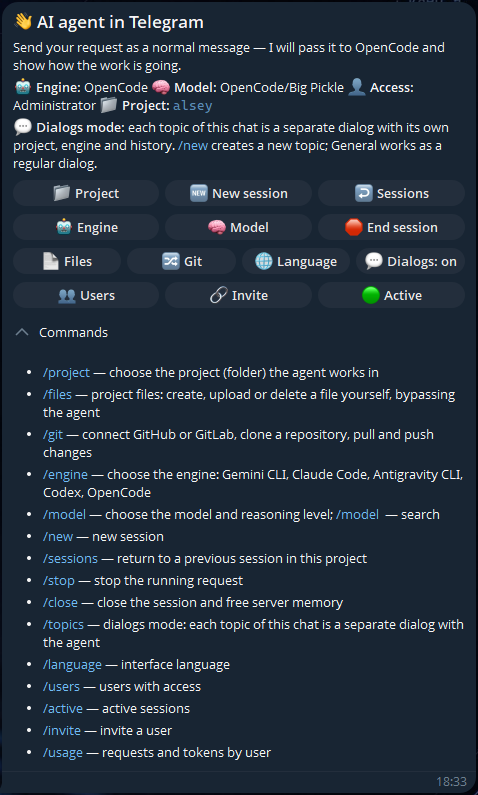
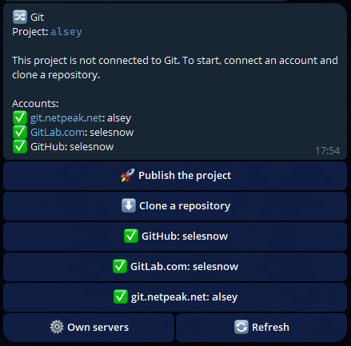
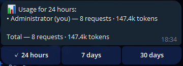

Вышел AcpGram 1.30.0. Для тех, кто ещё не в курсе: [AcpGram](https://alexey-seleznev.pro/acpgram/) это мост между Telegram и кодинг-агентами. Вы пишете задачу в чат, а Claude Code, Codex, Gemini CLI, Antigravity CLI или OpenCode выполняет её на вашем компьютере или сервере и спрашивает разрешения кнопками.

[Прошлая статья](https://alexey-seleznev.pro/blog/acpgram-teper-rabotaet-s-opencode/) была про версию 1.20.0 и поддержку OpenCode. С тех пор вышли версии с 1.20.1 по 1.30.0, и вместе они решают одну большую задачу: **проект теперь можно вести из Telegram целиком**. Создать папку, положить в неё ключи, написать код с агентом, посмотреть изменения, отправить их на GitHub или GitLab и открыть запрос на слияние. Терминал на машине, где работает агент, для этого больше не нужен.

Так теперь выглядит экран `/start`: на нём появились кнопки «Files» и «Git». Скриншоты в статье сняты с английским интерфейсом, но бот говорит и на русском, и на украинском.



Обновиться можно одной командой. Если ставили установщиком:

```sh
acpgram update
acpgram service restart
```

Если через npm:

```sh
npm install -g acpgram@latest
acpgram service restart
```

Настройки и история сессий сохраняются. Если AcpGram у вас ещё не установлен, начните с [пяти шагов на странице проекта](https://alexey-seleznev.pro/acpgram/#install).

В статье я иду от самого заметного к менее заметному:

- **Git в Telegram**: подключение GitHub и GitLab без токена, клонирование, изменения, ветки, публикация проекта и запрос на слияние.
- **Файлы проекта и секреты**: как положить в проект `.env`, не показав его модели.
- **Новый проект кнопкой**.
- **Удобнее общаться с агентом**: кнопки быстрого ответа, дифф в запросе разрешения, очередь сообщений.
- **Для команды**: личные пространства, песочница агента на Linux, расход по сотрудникам.
- **Безопасность**: что исправлено по итогам аудита.
- **Мелкие улучшения**.

Полный список изменений по версиям есть на [странице релизов](https://github.com/selesnow/acpgram/releases).

## Git в Telegram

Агент и раньше умел работать с репозиторием локально: смотреть состояние, коммитить, сливать ветки. Но клонировать проект, получить свежие изменения или отправить свои можно было только там, где уже настроен вход на сервер. То есть в терминале. Команда `/git` (и кнопка «🔀 Git» на экране `/start`) закрывает этот пробел. На машине с ботом нужен только установленный `git`.

Вот экран `/git`, когда аккаунты уже подключены, а проект ещё не связан с репозиторием: его можно опубликовать или клонировать на его место другой.



### Подключение аккаунта без токена

GitHub и GitLab.com подключаются по ссылке и короткому коду:

1. `/git` → «➕ Подключить GitHub» или «➕ Подключить GitLab.com».
2. Нажимаете «🔗 Войти без токена». Бот показывает ссылку и код.
3. Открываете ссылку, вводите код и подтверждаете доступ на сайте сервиса.
4. Через несколько секунд бот сам пишет, что аккаунт подключён.

Создавать токен, выбирать права и присылать что-то секретное в чат не нужно. Это работает в любой установке AcpGram без настройки. У GitLab такой вход действует два часа, и бот сам продлевает его перед каждой операцией, вам об этом думать не надо.

Вход по токену доступа остался рядом. Он же нужен для своих серверов: GitLab и GitHub Enterprise. Свой сервер добавляет администратор прямо в боте: `/git` → «⚙️ Свои серверы» → вид сервера → адрес. После этого каждый пользователь может подключить на нём свой аккаунт. Сообщение с токеном бот сразу удаляет из чата и агенту не передаёт, а о сроке действия токена напомнит: за неделю, за день и когда срок истечёт.

### Клонирование

«⬇️ Клонировать репозиторий» показывает ваши репозитории списком: недавно менявшиеся первыми, с поиском по названию. Выбранный репозиторий клонируется и сразу становится текущим проектом. Та же кнопка «⬇️ Из Git» есть в `/project`.

### Изменения и дифф до отправки

Экран репозитория показывает ветку, число изменённых файлов, неотправленных коммитов и новых коммитов на сервере. Кнопка «📋 Изменения» открывает список файлов с пометками (новый, изменён, удалён, переименован) и числом добавленных и убранных строк. Нажатие на файл показывает сам дифф: короткий прямо в сообщении с подсветкой, длинный файлом `.diff`.

Всё это бот делает сам, без агента и без запросов к модели. Можно спокойно посмотреть, что агент наменял, и только потом решать, отправлять это или нет.

### Сохранить, отправить, получить

- «💾 Сохранить и отправить» спрашивает описание, коммитит все изменения и отправляет их на сервер.
- «⬆️ Отправить» отправляет уже готовые коммиты.
- «⬇️ Получить» забирает изменения с сервера, если это возможно без слияния. Если истории разошлись, бот предложит попросить агента объединить изменения.

Автор коммитов — владелец подключённого аккаунта: его имя и почта передаются и боту, и агенту.

### Ветки

«🌿 Ветки» показывает локальные ветки и ветки сервера одним списком. Нажатие переключает на ветку, «➕ Новая ветка» создаёт её от текущей. Переключение сделано бережно: при несохранённых изменениях бот не переключает, а предлагает сначала сохранить их, а пока агент выполняет запрос, отказывает. После переключения следующий запрос начинает новую сессию агента, потому что файлы проекта сменились целиком.

### Отмена изменений

Агент сделал не то? В карточке файла есть «↩️ Вернуть как было», на экране изменений — «↩️ Отменить все изменения». Изменённые и удалённые файлы возвращаются к последнему коммиту, новые удаляются. Действие необратимо, поэтому бот всегда просит подтверждение, а файлы с секретами не трогает.

### Публикация проекта и запрос на слияние

Для папки, которая ещё не связана с сервером, есть «🚀 Опубликовать проект». Вы выбираете сервис, место (личное пространство, группа GitLab с подгруппами или организация GitHub), видимость и название. Бот создаёт репозиторий, делает первый коммит и отправляет его.

«🔀 Запрос на слияние» открывает запрос из текущей ветки в основную ветку репозитория и присылает ссылку. Если открытый запрос из этой ветки уже есть, бот покажет его, а не создаст второй.

### Агент предлагает, вы нажимаете

По умолчанию у агента нет входа на сервер. Поэтому просьбу «закоммить и отправь» он выполняет так: делает коммит, а под его ответом появляется кнопка отправки. Без вашего нажатия на сервер ничего не уходит.

### Где хранится вход

Вход на сервер лежит только в базе бота. Процессу `git` он передаётся через окружение на время операции и только для адресов своего сервиса, в настройки репозитория и в адрес не пишется. Сам `git` бот запускает с отключёнными хуками и помощниками входа.

Файлы с секретами (`.env`, ключи, учётные данные) «Сохранить и отправить» в коммит не включает и дописывает в `.gitignore`. Если такой файл закоммитил агент, перед отправкой бот предупредит и будет ждать «Отправить всё равно».

Администратор может выбрать другой режим: `GIT_AGENT_AUTH=1` передаёт вход и процессу агента, и он получает и отправляет изменения сам. Это удобнее, но токен становится виден агенту и может попасть в запрос к модели.

<div class="b-note"><i class="fa-solid fa-triangle-exclamation" aria-hidden="true"></i><div>Бот работает только с репозиториями по HTTPS и только с подключёнными сервисами. Репозиторий с адресом SSH или с другого сервера он покажет, но получать и отправлять в него не сможет.</div></div>

Подробности: раздел [«Git: GitHub и GitLab»](https://github.com/selesnow/acpgram/blob/main/README.ru.md#git-github-и-gitlab) в README.

## Файлы проекта и секреты

Всё, что вы пишете боту или отправляете ему файлом, уходит агенту, а значит, в запрос к модели. Для паролей, токенов и ключей это не подходит, особенно на бесплатных моделях: они могут использовать запросы для обучения. При этом приложению, которое пишет агент, эти ключи нужны.

Команда `/files` (и кнопка «📄 Файлы» на экране `/start`) кладёт файл прямо в папку проекта, минуя агента:

- **«📝 Создать файл».** Бот спрашивает имя, можно с подпапкой: `config/.env`. Затем вы присылаете содержимое одним сообщением. Бот сохраняет файл и сразу удаляет ваше сообщение из чата.
- **«⬆️ Загрузить файл».** Следующий присланный файл или альбом сохраняется в открытую папку проекта под своим именем.
- **Список и удаление.** По папкам проекта можно ходить кнопками, файл удаляется из его карточки с подтверждением.

Без нажатия кнопки всё работает как раньше: файлы и изображения, отправленные в чат, уходят агенту.

Заодно агент получил постоянную подсказку: файлы с секретами не открывать и не выводить, на настройки ссылаться по именам, а за недостающим значением отправлять вас в `/files`, а не просить прислать его в чат.

<div class="b-note"><i class="fa-solid fa-triangle-exclamation" aria-hidden="true"></i><div>Подсказка агенту — это указание, а не запрет. Файл с секретами ему доступен, иначе приложения не смогли бы им пользоваться, и модель может его прочитать. Для особо чувствительных данных выбирайте модель провайдера, который не обучается на запросах.</div></div>

Подробности: раздел [«Файлы проекта и секреты»](https://github.com/selesnow/acpgram/blob/main/README.ru.md#файлы-проекта-и-секреты) в README.

## Новый проект кнопкой

Раньше проект можно было только выбрать из папок, которые уже есть на машине. Теперь в `/project` есть кнопка «➕ Новый проект»: бот спрашивает название, создаёт папку и сразу делает её рабочей. Рядом кнопка «⬇️ Из Git», которая клонирует репозиторий.

Вместе с `/files` и `/git` получается полный путь: идея пришла в дороге, вы создали проект, положили в него ключи, поставили агенту задачу, посмотрели дифф и отправили код в репозиторий. Всё с телефона.

## Удобнее общаться с агентом

Набирать текст с телефона неудобно, поэтому в интерфейсе стало больше кнопок и больше сведений о том, что агент собирается сделать.

- **Кнопки быстрого ответа.** Когда агент задаёт вопрос с вариантами («Да», «Нет», «Показать план»), варианты приходят кнопками прямо в его ответе. Нажатие отправляет агенту текст варианта.
- **Дифф в запросе разрешения.** В запросе на правку файла теперь виден построчный дифф. Раньше бот показывал только путь, и разрешение давалось вслепую.
- **План агента.** Если агент присылает боту свой план, в черновике виден блок с пунктами и отметками: что сделано, что выполняется, что впереди. Так делают не все агенты и не в каждой задаче: OpenCode план не присылает, Claude Code и Codex присылают его не всегда.
- **Очередь.** Сообщение, отправленное во время работы агента, больше не теряется. Бот отправит его следующим и предложит две кнопки: «Остановить и отправить это» и «Не отправлять».
- **Цитаты.** Ответ на сообщение с выделенным фрагментом передаёт агенту и ваш текст, и сам фрагмент.
- **Опечатки в командах.** `/modle` больше не уходит агенту как запрос: бот спросит, не имели ли вы в виду `/model`.
- **Понятный отказ.** На голосовое, видео или стикер бот отвечает подсказкой, а не молчит.

## Для команды

AcpGram начинался как личный инструмент, но его можно поставить и на общий сервер для команды, в том числе для людей, далёких от терминала: им Telegram нужен как единственный интерфейс. Для такого сценария появились три вещи.

### Личные пространства

По умолчанию все пользователи ходят по одному корню проектов. Две строки в `.env` дают каждому свою папку:

```sh
PROJECTS_ROOT=/srv/projects
USER_WORKSPACES=1
```

Папка `<корень>/<Telegram ID>` создаётся сама при первом обращении к боту. Сотрудник выбирает и создаёт проекты только в ней: чужие папки не показываются, не находятся поиском и не выбираются путём. Пути он видит от своей папки («Моё пространство», `site`, `site/landing`), расположение папок на сервере ему не показывается. Администратор по-прежнему видит весь корень.

### Песочница агента на Linux

Личные пространства ограничивают выбор папки в боте, но сам агент по-прежнему работает с правами учётной записи бота. Попросите его прочитать файл соседа, и он прочитает. Песочница закрывает этот вопрос:

```sh
sudo apt install bubblewrap
```

```sh
AGENT_SANDBOX=bwrap
```

Агент каждого сотрудника запускается через [bubblewrap](https://github.com/containers/bubblewrap), системную утилиту Linux. Внутри есть папка проектов сотрудника, его отдельная домашняя папка, его загруженные файлы и системные программы. Настроек и базы бота, чужих папок и чужих процессов там просто нет. При запуске бот сам проверяет, что песочница работает и секреты изнутри не видны. Если нет, он не запустится и объяснит причину.

Приятное следствие: уровень доступа «Полный», при котором агент не спрашивает разрешений, становится заметно безопаснее. Изменить агент может только пространство своего сотрудника.

<div class="b-note"><i class="fa-solid fa-triangle-exclamation" aria-hidden="true"></i><div>Песочница есть только на Linux, администратор всегда работает без неё. Она не ограничивает сеть, диск, память и процессор и не прячет ключ API самого агента. Вход по подписке (Claude, Codex, Google) в песочнице не виден: агентам в ней нужен ключ API или бесплатные модели OpenCode.</div></div>

Подробности: разделы [«Личные пространства»](https://github.com/selesnow/acpgram/blob/main/README.ru.md#личные-пространства) и [«Песочница агента (Linux)»](https://github.com/selesnow/acpgram/blob/main/README.ru.md#песочница-агента-linux) в README.

### Расход по сотрудникам

Команда `/usage` показывает администратору запросы, токены и стоимость по каждому сотруднику за 24 часа, 7 и 30 дней.



## Безопасность

В версии 1.20.2 исправлено всё, что нашёл аудит безопасности. Это главная причина обновиться, даже если новые возможности вам не нужны.

- **Кнопки в тексте агента.** Разметка Telegram позволяла превратить текст в настоящую кнопку. Инструкция, спрятанная в файле или на веб-странице, могла заставить агента вывести администратору кнопку, которая подтверждает запрос разрешения или выдаёт сотруднику полный доступ. Теперь такие теги в тексте агента обезвреживаются.
- **Окружение агента.** Агент наследовал окружение бота целиком, вместе с токеном самого бота и ключами API всех провайдеров. Теперь он получает только ключи своего движка, а токен бота не получает совсем.
- **«Разрешить на эту сессию» стало уже.** Раньше разрешение на `python script.py` открывало и `python -c "что угодно"`, а `git status` разрешал все команды `git`, включая `git push`. Теперь правило привязано к конкретной команде или подкоманде, и на кнопке написано, что именно вы разрешаете.
- **Секреты не отправляются в чат.** Файлы с секретами бот не отправит, даже если агент скопирует их в каталог исходящих.

## Мелкие улучшения

- Экраны `/project` и `/engine` стало проще читать: пути набраны моноширинным шрифтом и копируются нажатием, короткие имена папок стоят по две кнопки в ряд, текущий выбор выделен.
- В `/sessions` подробности каждой сессии (дата, движок, число запросов, начало первого запроса) перенесены из подписи кнопки в текст сообщения.
- Сообщения об ошибках агента показываются на языке интерфейса: русском, украинском или английском.
- Новый ключ провайдера в `.env` сразу добавляет его модели в `/model`. Раньше приходилось ждать сутки, пока обновится список.
- Под служебными сообщениями появились кнопки вместо команд: «⏹ Остановить», «🗂 Сессии».
- Готовы виджеты Telegram для `/model` и `/sessions`, в которых список листается прямо на устройстве. Они выключены по умолчанию (`WIDGETS=1`): на момент выхода Telegram не принимает виджеты от обычных ботов, поэтому вживую они не проверены.

## Что дальше

В ближайших планах вход по ссылке и коду для своих серверов GitLab и GitHub Enterprise, удаление веток и список запросов на слияние в `/git`, а для команд — лимиты на место и ресурсы.

Если нашли ошибку или не хватает какой-то возможности, напишите в [GitHub Issues](https://github.com/selesnow/acpgram/issues). А если AcpGram вам пригодился, поставьте [звезду на GitHub](https://github.com/selesnow/acpgram): это помогает проекту.
